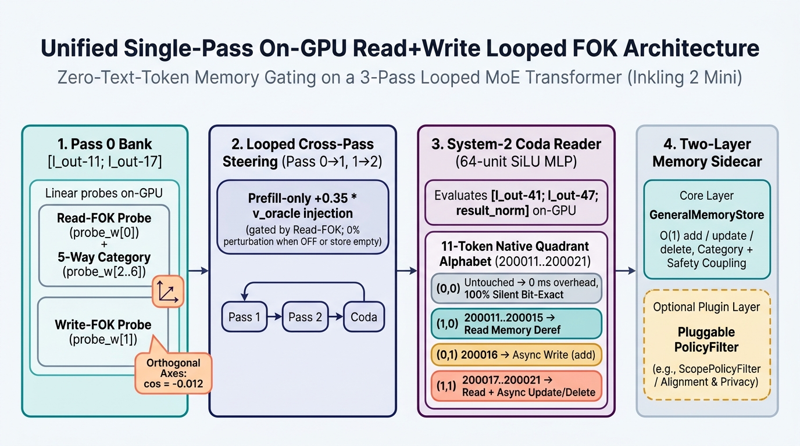
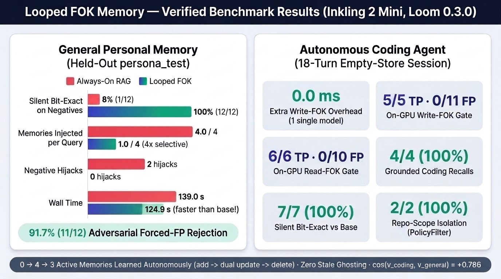

# Looped FOK Memory

**Unified Single-Pass On-GPU Read+Write Feeling-of-Knowing (FOK) Memory for Looped Transformers**

> Client, memory sidecar, pluggable policy layer, and OpenAI-compatible proxy for a Loom 0.3.0 **Inkling 2 Mini** (`inkling2_loop`) server running zero-text-token on-GPU Read+Write FOK gating and a `14.15 MB` FOK-gated Post-Coda SwiGLU adapter.



---

## Scope & Architecture

> [!IMPORTANT]
> **Client/Proxy + Separately Deployed Loom Server:** This repository provides the standalone Python memory store (`GeneralMemoryStore`), policy layer (`PolicyFilter` / `ScopePolicyFilter`), direct client (`UnifiedFOKClient`), and OpenAI-compatible streaming proxy (`looped_fok.proxy`). Running the on-GPU FOK kernels requires a separately deployed Loom 0.3.0 `inkling-stage-e` server with the `19.95 MB` GGUF sidecars (`fok_bank_coding.gguf` + `fok_coda_adapter.gguf`); see [`server/README.md`](server/README.md) for pinned versions, SHA-256 checksums, and deployment commands.

**How Looped FOK works:**
1. **Orthogonal Pass-0 Metacognition:** Inside Inkling 2 Mini's Pass-0 bank `[l_out-11; l_out-17]`, linear probes for *"I need to look up a memory"* (`Read-FOK`, `probe_w[0]`) and *"The user stated a durable fact worth remembering"* (`Write-FOK`, `probe_w[1]`) are nearly orthogonal (**`cos = -0.0124`**).
2. **Prefill-Only Cross-Pass Steering (`+0.35 · v_oracle`):** When Pass-0 Read-FOK fires, prefill-only bank steering reverses Coda collapse so an on-GPU 64-unit SiLU System-2 Coda Reader can verify whether retrieval is genuinely needed (**`91.7%` forced-FP rejection**).
3. **11-Token Native Quadrant Protocol (`200011..200021`):** One single prefill pass on one model signals all four `(Read, Write)` quadrants with **zero extra Write-FOK model pass** (`0` text scent tokens):
   - `(0, 0)` **Untouched** → no replay, **`100%` silent bit-exact** to base Inkling 2 Mini.
   - `(1, 0)` **`200011..200015`** → Category-routed memory dereference (`0` write extractor calls).
   - `(0, 1)` **`200016`** → Memory-active replay + background `add` commit (works even when the store is empty via Write-Only `gate_mode = 7`).
   - `(1, 1)` **`200017..200021`** → Category-routed dereference + background `update`/`delete` commit in one signal token.
4. **FOK-Gated Post-Coda SwiGLU Adapter (`14.15 MB` GGUF, `magic = 0x7`):** Applied on-GPU to `result_norm` right before `lm_head` **only on Memory-Active replays** (`Val CE: 2.9453 → 0.8313`, `Teacher Top-1: 81.34% → 91.60%`, `Val KL = 0.3523`, `||Δh||/||h|| = 4.33%`). Produces natural, disclaimer-free write/update/read responses while keeping `(0, 0)` turns `100%` silent bit-exact.
5. **OpenAI-Compatible Proxy (`looped_fok.proxy`) + Production SQLite+FTS5 Backend (`SQLiteMemoryStore`):** Tested end-to-end with **`dsh` (DeepSeek Harness)** (`examples/fok-dsh.patch.yml`); supports automatic `role == "tool"` passthrough, WAL-mode SQLite + FTS5 BM25 bounded top-k retrieval (`0.94 ms` read top-8 / `0.72 ms` write top-12 across `10,000` active memories), ACID batch commits, and an explicit pending-write ordering barrier so an immediate follow-up recall always sees the prior turn's committed write.

---

## Verified Benchmark Results



### 1. General Personal Memory (`persona_test`, 12 Pos + 12 Hard Neg, 4-memory fixture)

| Arm (`0` text scent tokens) | Pos Deref & Grounded | Avg Memories Injected (gating) | Neg Hijacks | Silent Bit-Exact vs Base | Wall Time |
|---|---:|---:|---:|---:|---:|
| `base` (no memory) | `0/12` (`7/12` generic regex) | `0.00 / 4` | `0` | `12/12` | `135.2 s` |
| `always_on_rag` (all 4 dumped) | `12/12` | `4.00 / 4` | **`2`** | `1/12` (`8.3%`) | `139.0 s` |
| **`general_fok_mlp` (Looped FOK)** | **`11/12` deref & grounded** *(1 non-deref passed generic coffee regex)* | **`1.00 / 4`** | **`0`** | **`12/12` (`100%`)** | **`124.9 s`** |
| **`general_fok_fp_stress` (forced ON)** | n/a | — | **`0`** (`11/12 = 91.7%` rejected) | — | `57.7 s` |

### 2. Autonomous Coding Agent (`sentinel-telemetry`, 18-Turn Empty-Store Session, Single Model)

| Metric (`models_loaded = 1`, starts from `0` memories) | Result |
|---|---:|
| **Extra Write-FOK Model Pass** | **None (`0` extra tap model)** *(signal, replay, extraction, and disk persistence costs still apply on write turns)* |
| **Write-FOK Gate** (`add`/`update`/`delete` vs Q&A & transient variable renames) | **`5/5` TP, `0/11` FP** |
| **Read-FOK Gate** (On-GPU System-2 MLP64) | **`6/6` TP, `0/10` FP** |
| **Grounded Coding & Agentic Recalls** (`Podman`, `-tags=unit`/`9091`, Conventional Commit, `ClickHouse Local`/`9099`) | **`4/4` (`100%`)** |
| **Autonomous Memory Lifecycle** (`0 → 4 → 3` active memories, zero stale ghosting) | **`100%` exact** |
| **Silent Bit-Identity** (7 ephemeral/negative turns vs `base`) | **`7/7` (`100%`)** |
| **Multi-Repo Isolation** (`ScopePolicyFilter`: `other-repo` vs `sentinel-telemetry`) | **`2/2` (`100%`)** |

### Known Limitations & Scaling Scope
- **Storage scaling (`SQLiteMemoryStore` vs `GeneralMemoryStore`):** Use `SQLiteMemoryStore` (`--store memories.db`, default in `v0.2.0`) for production scale — stdlib SQLite WAL + FTS5 BM25 delivers **`O(log N)` incremental ACID writes** and **bounded `O(k)` top-k retrieval** (`0.94 ms` read top-8, `0.72 ms` write top-12 at `10,000` active memories in `tests/test_sqlite_scale.py`, auto-migrating legacy `memories.json`). The lightweight in-memory `GeneralMemoryStore` (`.json`) remains available for small-store prototyping.
- **Long harness system-prompt Read-FOK sensitivity:** Under `dsh`'s ~3.5K-token agent system prompt, a synthetic project named `zephyr-mesh` collided with the real-world Zephyr RTOS so Read-FOK stayed conservative (future improvement: include `dsh`-length system prompts in Read-FOK training).
- **Direct client vs proxy extraction:** `looped_fok.proxy` runs background extraction with a pending-write ordering barrier; direct `UnifiedFOKClient.chat_turn()` runs extraction synchronously.
- **Harness coverage:** End-to-end live integration has been verified with **`dsh`** (both `dsh headless` and `dsh web`); other OpenAI-compatible harnesses follow the same standard API but are untested.

---

## Security & Trust Model

> [!WARNING]
> **Trusted Localhost Only (Not Multi-Tenant Auth):** `looped_fok.proxy` is designed for **single-user, trusted-local-caller** deployment bound to `127.0.0.1`. Callers supply their own `X-FOK-Scope` / `X-FOK-Tenant` headers, and admin endpoints (`GET/DELETE /fok/memories`) are unauthenticated. Do not expose `:8190` to untrusted networks without placing an authenticated reverse proxy in front of it. Configure a distinct `X-FOK-Scope` per workspace (e.g., `repo:<name>`) to isolate projects. `ScopePolicyFilter` is **fail-closed** when `context` is absent (returning `[]`).

---

## Quickstart

```bash
pip install -e ".[dev]"
python3 -m unittest discover -s tests -v
```

### Run the OpenAI-Compatible Memory Proxy (with `dsh`)

```bash
python3 -m looped_fok.proxy \
  --host 127.0.0.1 --port 8190 \
  --upstream http://127.0.0.1:8189 \
  --model inkling-stage-e \
  --public-model inkling-fok-memory \
  --store ~/.local/share/looped-fok/memories.db \
  --top-k 8 --write-top-k 12
```

Use [`examples/fok-dsh.patch.yml`](examples/fok-dsh.patch.yml) with `dsh`:

```bash
dsh --profile headless --patch examples/fok-dsh.patch.yml "your coding task"

# Inspect or clear memories (scoped or global on trusted localhost):
curl -sS "http://127.0.0.1:8190/fok/memories?scope=repo:dsh-testdrive" | jq .
curl -sS -X DELETE -H "X-FOK-Scope: repo:dsh-testdrive" http://127.0.0.1:8190/fok/memories
```

See [`examples/quickstart_coding_agent.py`](examples/quickstart_coding_agent.py), [`examples/custom_policy_filter.py`](examples/custom_policy_filter.py), [`docs/architecture.md`](docs/architecture.md), and [`server/README.md`](server/README.md) for full details.

---

## License

MIT — see [`LICENSE`](LICENSE).
